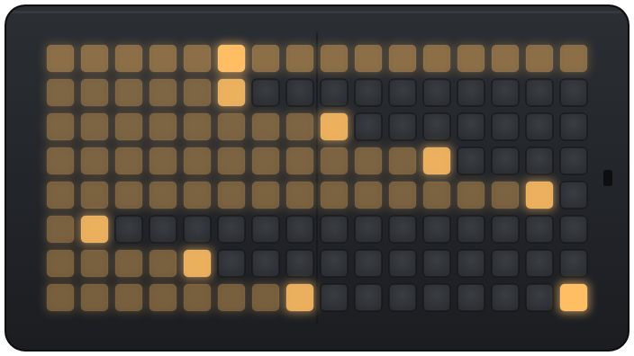

# parterre

parterre is a firmware for grid controllers. It runs monome's
[iii](https://monome.org/docs/iii/), so Lua scripts play on the grid itself,
and it also plays norns and serialosc as a monome-compatible grid. It runs on
an RP2040 and today drives
[FREEPOET's Open Grid kit](https://github.com/FREEPOET-OFFICIAL/FREEPOET_Keypad);
builds for monome's own grids are planned. parterre is not made or supported
by monome.

## The hardware

parterre runs on FREEPOET's Open Grid kit: two 8×8 FREEPOET keypad boards
side by side make a 16×8 grid, with an LED under each key (16 levels of
brightness), read by an RP2040-Zero, in a 3D-printed low-profile case. The
kit, its boards and its case are FREEPOET's design; see their
[repository](https://github.com/FreepoetOfficial/Open-Grid-Controller) for
the parts and the assembly.

The grid has a small hole on in the bottom of the case for accessing the BOOT
button on the RP2040-Zero. Use a small tool, such as a paperclip, to press it
through the hole if neededw.

The firmware reads the keypads through a small layer of its own, so other
keypad hardware (other sizes, or boards such as denki-oto's mechatrellis)
could become further backends.

## Two modes

parterre has two modes and stays in the last one you chose, even unplugged.

| mode              | status LED | shows up as                   | use it with                                                                                                                                   |
| ----------------- | ---------- | ----------------------------- | --------------------------------------------------------------------------------------------------------------------------------------------- |
| **iii** (default) | green      | USB MIDI and a serial console | [greenhouse](https://greenhouse.vfmod.com) to write and upload Lua scripts; the scripts then play any DAW or synth over USB MIDI on their own |
| **monome serial** | blue       | a monome grid                 | **norns** directly, and Max/MSP, Pure Data, SuperCollider, VCV Rack or TouchDesigner on a computer through monome's serialosc                 |

### Starting up

Parterre indicates its mode at startup with a light pattern on the grid.

The “mode” is indicated by the startup light pattern.

> **particles**: this is standard monome/serial mode, compatible with norns, serialosc, ansible, etc.
>
> **waves**: iii mode
>
> (Particles looks like an explosion, waves more like ripples).

**To switch between modes, hold the top-left (1,1) button while plugging in the device. Let go
as soon as the animation starts.**

When switching to iii, if you keep holding for about 1 second (until the top row fills up, then
lights fully) the startup will skip `init.lua` and start with no script. This is useful if
troubleshooting a problematic startup script.
Letting go earlier starts iii as usual.

Greenhouse can also be used to switch modes programmatically, using the `pt_set_mode` function
(`og_set_mode` before 0.4) or the buttons in the toolbar.

## Scripts in iii mode

In iii mode the grid runs monome's [iii](https://monome.org/docs/iii/): Lua
scripts stored on the device decide what each key does and what lights up.
Scripts written for monome's own iii grids run unchanged.

Open [greenhouse.vfmod.com](https://greenhouse.vfmod.com) in Chrome, Edge or
Opera and connect over USB. greenhouse has a console that talks to the grid
live, an editor, a view of the grid that mirrors its LEDs and plays its keys
from the screen, a MIDI monitor, and **graft**, a patch editor that wires grid
widgets (buttons, faders, a step sequencer, a keyboard, ripples) into a
script without writing code.

A good first script is [many-roads](https://github.com/boreal-ground/many-roads-grid),
a launcher that lights one key per script on the grid.

## When something goes wrong

### Starting without the script

In iii mode the grid calls `init.lua` and runs its start-up script (the one chosen as `first` in
greenhouse) every time it starts. If that script locks the grid up, start
it without the script, fix or replace the script from greenhouse, and plug
in again. Nothing is deleted: the script is only skipped this once. Either
way below, the status LED turns **amber** and greenhouse's console shows
`-- init: skip script`.

- **With the keys**, as on monome's grids: switch into iii while holding the
  top-left key, and keep holding.
  1. Start from monome serial (particles at startup). If the grid is in iii,
     first plug in once with the top-left key held to get there.
  2. Unplug, hold the top-left key, and plug in.
  3. Keep holding while the top row fills up, about a second.
  4. When the whole row lights up brightly, let go. Plasma plays and iii
     starts with no script.

  Letting go before the row is full starts iii normally, with the script.

- **With the BOOT button**: plug in, then press BOOT while the status LED is
  cyan (the first second). This works from either mode and with no keypads,
  and always starts in iii.

Holding BOOT _while_ plugging in does something else: it opens the firmware
update drive (see [Updating the firmware](#updating-the-firmware)).

### A script that hangs while running

If the grid stops responding for 8 seconds, a watchdog restarts it, script
and all, so a performance setup comes back on its own. If it hangs again
within 30 seconds of starting, the next start skips the script (status LED
amber) so you can fix it from greenhouse, which shows a `watchdog:` line
when it connects.

## MIDI to hardware (DIY)

Every MIDI message a script sends over USB also goes out a pin at MIDI speed,
so with a 3.5 mm TRS jack and two resistors the grid can play a synth from a
USB power bank, no computer. The wiring is in the
[repository's README](https://github.com/VoltageFoundryMod/parterre#trs-midi-out-diy-og-0313-or-later).

## Updating the firmware

When the grid connects, greenhouse checks for a newer firmware release and
offers it. To install one: hold BOOT while plugging in, so the
grid shows up as an `RPI-RP2` drive, and drag the `.uf2` file for your board
from the [releases](https://github.com/VoltageFoundryMod/parterre/releases)
onto it. Your scripts are kept.

## Credits

parterre's iii firmware is GPL-3.0, built on monome's iii. The Open Grid kit,
its keypad boards and its enclosure are by FREEPOET.
